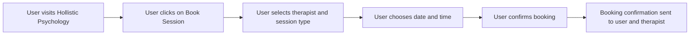

# Hollistic Psychology Booking App PRD

## Overview
The Hollistic Psychology Booking App aims to provide a seamless and HIPAA-compliant platform for families, victims of domestic violence, single mothers, and low-income families to book Hollistic Psychological Therapeutic Services. The app will offer in-person and online therapy sessions, catering to the specific needs of its target audience.

## Problem Statement
The current process of finding and booking psychological therapeutic services can be daunting and time-consuming, especially for vulnerable populations such as victims of domestic violence and low-income families. The lack of a streamlined and HIPAA-compliant platform hinders access to necessary care, exacerbating the mental health crisis.

## Target Audience
The target audience includes:

* Families seeking therapeutic services
* Victims of domestic violence (with a specialty in serving women)
* Single mothers with children
* Youth therapy
* Low-income families in need of therapeutic services

## MVP Feature Scope
For the MVP, the scope includes:

* User registration and login functionality
* Booking system for in-person and online therapy sessions
* Basic therapist profile management
* SEO optimization for improved discoverability
* HIPAA-compliant data storage and transmission

## User Stories

* As a user, I want to register and log in to the platform to access booking features.
* As a user, I want to book a therapy session with a therapist who meets my needs.
* As a therapist, I want to manage my profile and availability to receive bookings.

## Core Features
The core features of the Hollistic Psychology Booking App include:

* In-person and online Hollistic Style Psychological Services
* Booking system with calendar integration
* Therapist profile management with filtering and search functionality

## User Flow
The following Mermaid diagram illustrates the user flow for booking a therapy session:

## Technical Stack
The technical stack for the Hollistic Psychology Booking App includes:

* Frontend: Vite React
* Backend: Hono
* Hosting: Cloudflare
* Database: Firebase

## Assumptions & Constraints
Assumptions:

* The development team has mid-senior or less experience.
* The app will be built within a timeframe of less than one week.

Constraints:

* Limited development time (less than one week)
* Need for HIPAA compliance

## Success Metrics
The success metrics for the Hollistic Psychology Booking App include:

* User acquisition: 100-1000 users within the first week
* Booking conversion rate: measure the percentage of users who successfully book a session
* User engagement: measure user retention and session frequency